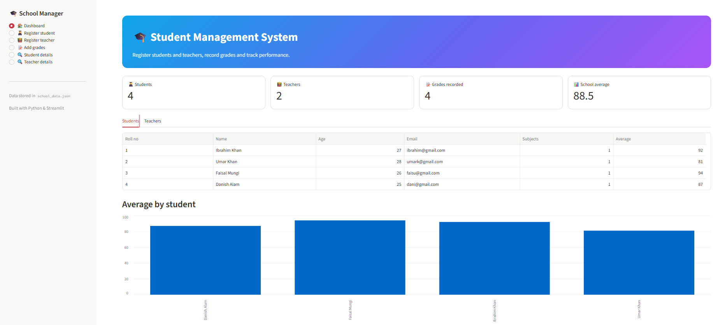

# 🎓 Student Management System — Streamlit App

A clean web app to **register students and teachers, record grades and track performance**, built with Python, object-oriented programming and [Streamlit](https://streamlit.io).

It started as a command-line project and was turned into a browser UI.



## ✨ Features

- 🏠 **Dashboard** — totals, school average, student & teacher tables, and an average-by-student chart
- 🧑‍🎓 **Register students** — name, age, email, roll number (with email validation and duplicate checks)
- 👩‍🏫 **Register teachers** — name, age, email, subject, employee ID
- 📝 **Add grades** — add or update marks per subject
- 🔍 **Student details** — profile, average, best subject and a grades chart
- 🔍 **Teacher details** — profile and subject
- 💾 Data saved in a local `school_data.json` file

## 🧱 OOP design

```
Persons (abstract base class)
├── Student  → register, find, add_grade, average
└── Teacher  → register, find
```

`Persons` defines the shared interface (`get_roles`, `register`, `find`) and a static `validate_email` method that both subclasses use.

## 🚀 Getting started

```bash
git clone https://github.com/ZeeshanAnsari99/student-management.git
cd student-management
pip install -r requirements.txt
streamlit run app.py
```

The app opens at `http://localhost:8501`.

## 📂 Project structure

```
student-management/
├── app.py            # Streamlit app + OOP classes
├── requirements.txt
├── README.md
└── school_data.json  # Created automatically (not uploaded to GitHub)
```

## 🛠️ Built with

- Python 3.10+
- Streamlit
- pandas
